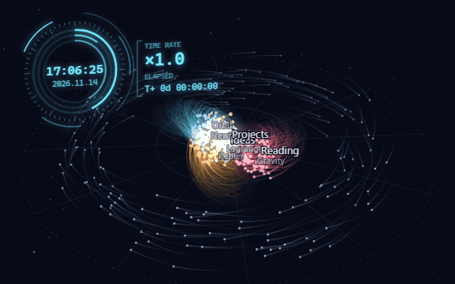
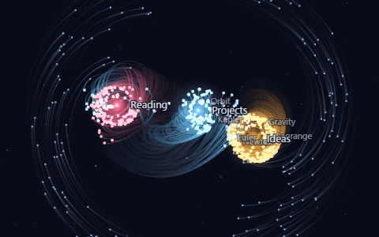
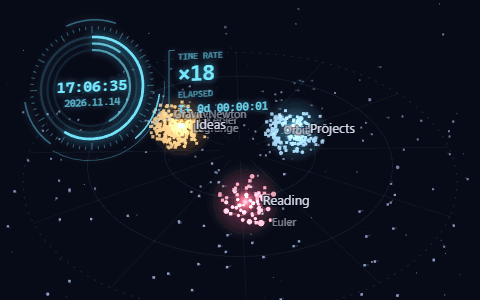

# Sayu Three-Body Problem

Obsidian のノートを、三体問題の重力シミュレーションで動く3次元の星系として表示するグラフビュー。

- リンクの多い上位3ノートが「恒星」になり、互いの重力で運動する
- 恒星につながるノートは、リンクの近い恒星を回る「惑星」になる
- どこにもつながらないノートは、星系全体を回る外縁の帯になる

## 三体問題とは

重力で引き合う天体が2つだけなら、動きは式で書ける。互いのまわりを楕円で回り続けるだけで、何年先の位置でも計算できる。

ところが天体が3つになると、事情がまったく変わる。二体のときのような、どんな初期条件にも使える手頃な「解の公式」は作れないことが、19世紀末のポアンカレの研究で明らかになった。しかも動きはカオスになる。最初の位置や速度がほんのわずか違うだけで、しばらくすると全く別の動きになり、遠い未来は事実上予測できない。3つの天体は近づいては弾き合い、ときには1つが遠くへ放り出される。

それでも、きれいに繰り返す特別な解がいくつか見つかっている。

| 解 | 見つかった時期 | 動き |
| --- | --- | --- |
| 一直線の解 | 1767年（オイラー） | 3つが一直線に並んだまま回る |
| 正三角形の解 | 1772年（ラグランジュ） | 正三角形の形を保ったまま回る |
| 8の字の解 | 1993年に数値的に発見（ムーア）、2000年に証明（シャンシネとモンゴメリ） | 同じ質量の3つが、1本の8の字の上を追いかけ合う |

このプラグインは、このうち正三角形と8の字、そして何の工夫もないカオスの3つを、ノートのグラフの上で動かす。

## 3つのモード

### 8の字（周期解）

3つの恒星が、同じ8の字の軌道を等間隔で追いかけ合う。乱れに強い珍しい解で、放っておいてもずっと続く。恒星同士がすれ違うたびに、外側の惑星が引き剥がされて別の恒星へ渡っていく。

### 三角形（秩序 → 崩壊）

正三角形を保って静かに回り始める。ただし質量が同じ3つでは、この形は不安定で、目に見えないほどのずれが少しずつ育ち、ある時点で一気に崩れてカオスになる。いつ崩れるかは毎回違う。

### カオス

冒頭の動画がこのモード。恒星の位置と速度を毎回ランダムに決める。恒星の重さはリンク数に応じて少し変わる。接近、弾き合い、惑星の奪い合いが続き、同じ動きは二度と現れない。

## 構造（リンクとフォルダ）

何を「つながり」とみなすかを、パネルの「構造」で選べる。

| 構造 | つながりの元 |
| --- | --- |
| リンク | ノート同士のリンクだけ（初期設定） |
| フォルダ | フォルダの入れ子だけ。リンクは見ない |
| リンク＋フォルダ | 両方 |

フォルダを使うと、フォルダそのものも天体として現れる（輪のついた点、名前の末尾に `/`）。フォルダは中のノートやサブフォルダとつながるので、ノートの多いフォルダが恒星になり、中身がそのまわりを回る。フォルダの天体はクリックしても開かない。

## 時計

左上に、現在の時刻を示す時計が出る。速度を上げると星系の動きと一緒に時計も速く進む。

- 速度 1 のときは現実の時刻そのまま（×1）
- 速度を 1 上げるごとに 60 倍になる。速度 2 で 1 秒に 1 分、速度 3 で 1 秒に 1 時間、最大の 4 では 1 秒に約 2.5 日進む
- 「ELAPSED」は、現実の時刻からどれだけ先へ進んだか
- 一時停止すると時計も止まる。リセットすると速度が 1 に戻り、時計も現在の時刻に戻る

時計はパネルの「時計を表示」で消せる。

## 操作

- クリック: ノートを新しいタブで開く（Ctrl+クリックで分割）
- Shift+クリック: その天体を追従（もう一度で解除）
- ドラッグ: 視点を回転 ／ 右ドラッグ: 視点移動 ／ ホイール: ズーム ／ ダブルクリック: 視点リセット
- ホバー: リンク先を強調表示
- 右上のパネル: モード、構造、速度、軌跡の長さ、リンク・ラベル・時計の表示

## インストール

`manifest.json` `main.js` `styles.css` を Vault の `.obsidian/plugins/sayu-three-body-problem/` に置き、設定 → コミュニティプラグインで有効にする。リボンのアイコン、またはコマンド「三体問題グラフを開く」で表示。

## シミュレーションについて

3つの恒星の動きは、互いの重力をそのまま数値計算している（蛙飛び法）。8の字の解は10周しても位置のずれが0.01%未満に収まる。

一方で、ずっと眺めていられるように、次の点は本物の宇宙と変えてある。

- 惑星には質量がない。恒星からは引かれるが、恒星や他の惑星を引き返さない
- 天体同士がごく近づいたときの重力は弱めてある（速度が跳ね上がって飛び去るのを防ぐ）
- 三角形とカオスのモードでは、恒星を画面の中心へ弱く引き戻している（本物の三体では、いずれ1つが放り出されて戻ってこない）
- はぐれた惑星は、近くの恒星に少しずつ速度を合わせて、また捕まる
- 8の字と三角形の解はもともと平面上の動きなので、この2つのモードの恒星は1枚の平面の上を動く（三角形は崩れたあと平面から外れていく）。惑星とカオスモードの恒星は3次元で動く
- 時計の進み方は演出で、星系の動く速さとは比例しない（星系は速度に比例、時計は速度 1 ごとに 60 倍）
